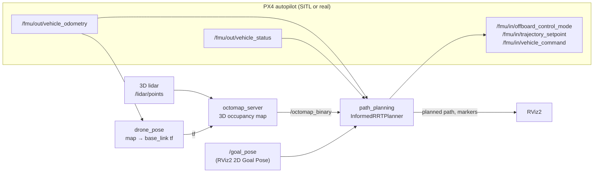
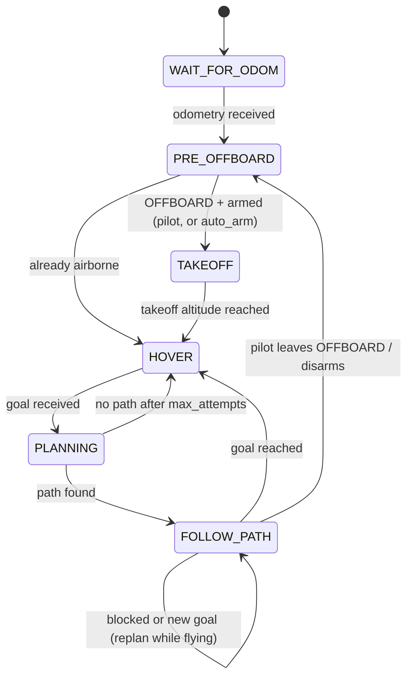

<div id="header" align="center">
  
</div>

# ROS-Informed-RRT* planner

Autonomous 3D navigation with obstacle avoidance for a PX4 multirotor on ROS 2.

Give it a goal, for example with RViz2's **2D Goal Pose**. The planner:

1. Builds a 3D occupancy map from a lidar as the drone flies.
2. Plans a collision-free path with Informed-RRT*.
3. Flies the path smoothly in PX4 OFFBOARD mode.
4. Replans in flight whenever newly mapped obstacles block the path.

It runs on ROS 2 Lyrical with PX4 main. PX4 is reached through its native Zenoh client and
`rmw_zenoh_cpp`; the uXRCE-DDS bridge also works. The whole stack is tested end to end in PX4
SITL with Gazebo Jetty.

The repository holds one ROS 2 package, [`path_planning`](path_planning/). Its own
[README](path_planning/README.md) is the short reference for build commands, launch arguments
and interfaces. This page explains what the system does and how.

## How it works



Three nodes make up the pipeline.

**[`drone_pose`](https://github.com/Fixit-Davide/PX4-ROS2-Drone-Composable)** (separate repo)
turns PX4's `VehicleOdometry` (NED position, FRD attitude) into the `map → base_link` tf, a
`/vehicle_pose` and a bounded `/vehicle_path` track. A static `base_link → lidar_link` tf
places the sensor.

**`octomap_server`** inserts every lidar scan into an
[OctoMap](https://octomap.github.io/) at 0.2 m resolution:

- Rays mark free space along their length and occupied space where they hit.
- Points below 0.3 m are dropped, so the ground is not mapped as an obstacle.
- The map is published as `/octomap_binary` at the scan rate.

**`path_planning`** is a composable node, `path_planning::InformedRRTPlanner`, that does
everything else. The stages are described below.

### 1. Collision checking (FCL)

Each new octomap is wrapped in an [FCL](https://github.com/flexible-collision-library/fcl)
`OcTree`. The drone is modeled as a box, `robot.size`, by default 0.9 × 0.9 × 0.6 m: the x500
airframe plus a safety margin. A position is free when that box does not touch an occupied
voxel. A segment is free when every sample along it, every
`planner.collision_check_resolution` (0.1 m), is free.

Two collision worlds share the same octree:

- **Planning world:** the box grown by `robot.planning_margin` (0.15 m per side).
- **Checking world:** the plain box, used to recheck paths that are already planned.

A new voxel therefore has to intrude more than the margin into a path's clearance before the
path counts as blocked. Without this hysteresis, every scan near a wall would trigger a
replan, because RRT* paths hug the boundary they are planned with.

### 2. Path planning (OMPL Informed-RRT*)

Planning runs on a background thread, so the setpoint stream to PX4 never stops. It searches
the 3D position space (R³) inside the box `bounds.min`–`bounds.max`, by default
40 × 40 m and 0.5–4 m in altitude. Yaw is not part of the search: the drone yaws along the
path.

- **Planner:** [OMPL](https://ompl.kavrakilab.org/)'s Informed-RRT*. It's an anytime planner:
  it uses the whole `planner.solve_time` (1 s) budget, and once it has a solution it samples
  only inside the ellipsoid that could still improve on it.
- **Objective** (`planner.objective`):
  - `path_length`: shortest path.
  - `path_length_cost_to_go`: shortest path, with a cost-to-go heuristic. This is the default.
  - `threshold`: stop at the first path shorter than `cost_threshold`.
  - `balanced`: trade length against clearance from obstacles, using plain RRT*.
- **Invalid starts or goals:** a start or goal inside an inflated obstacle, for example when
  the drone hovers close to a wall, is moved to the nearest valid state within 1.2 m.
- **Post-processing:** the solution is shortcut, smoothed with a B-spline (kept only if still
  collision-free) and re-sampled every `planner.waypoint_spacing` (1 m).
- **Retries:** a failed plan is retried up to `planner.max_attempts` (3) times, each with
  twice the previous solve time (1, 2, then 4 s).

### 3. Path following

A waypoint list fed to PX4 as bare position setpoints makes the drone surge toward each
waypoint and brake at it. Instead, the path is flown as a trajectory.

- **Speed profile** (`PathTrajectory`): the path is parameterized by arc length, with a speed
  limit along it:
  - at most `control.max_speed` (1.5 m/s);
  - corner speeds from `control.max_lateral_accel` and the turn angle at each waypoint;
  - a stop at the goal;
  - all of it reachable by braking at `control.max_accel`.
- **Reference:** every control tick (20 Hz) a reference point advances along the path. Its
  acceleration is limited to `max_accel` (braking up to twice that), and changes by at most
  `control.max_jerk` (2 m/s³). It tapers off before the speed limit, and braking looks ahead
  so it can ramp in smoothly.
- **What PX4 receives:** a `TrajectorySetpoint` with the reference position, velocity and
  acceleration as feed-forward, plus a yaw that follows the path direction at up to
  `control.max_yaw_rate`.
- **Lag guard:** if the drone falls more than `control.tracking_lag_soft` (1 m) behind, the
  reference slows down, and it waits at `tracking_lag_max` (2 m).

In SITL this turned a stop-and-go 10 m leg (speed oscillating between 0.6 and 0.8 m/s,
16.6 s) into one acceleration, a 1.5 m/s cruise and one stop (10.5 s), with under 0.2 m of
tracking error.

### 4. Replanning in flight

At `control.replan_check_rate_hz` (2 Hz) the rest of the path is rechecked against the newest
map. When newly mapped obstacles block it:

- **The drone keeps flying.** It brakes along the path only if the blocked section is within
  reach, stopping `control.stop_margin` (0.5 m) before it.
- **The new plan starts ahead.** It starts at the point the reference will have reached when
  the plan is ready.
- **The new path is spliced on.** It is joined onto the current reference, so position and
  speed stay continuous.

A new goal sent mid-flight is handled the same way.

### 5. Flight state machine



**Before a goal:**

- The node streams `OffboardControlMode` and a setpoint at `control.rate_hz`. PX4 needs more
  than 2 Hz to accept and keep OFFBOARD.
- With `control.auto_arm` the node switches PX4 to OFFBOARD and arms it itself, which is
  meant for simulation. Otherwise the pilot does both from the RC or ground station.
- Once armed it resets the map, then climbs to `control.takeoff_altitude` (2 m).

**Pilot takeover:** if the pilot leaves OFFBOARD or disarms, the path is dropped. The node
will not request OFFBOARD again until the vehicle has been disarmed, so it never fights the
pilot.

## Repository layout

```
path_planning/
├── include/path_planning/
│   ├── informed_rrt_planner.hpp   node: state machine, planning thread, PX4 interface
│   ├── collision_world.hpp        FCL octree + robot box collision queries
│   ├── path_trajectory.hpp        arc-length path, speed profile, projection
│   └── px4_frames.hpp             NED/FRD <-> map frame (NWU or ENU) conversions
├── src/                           implementations of the above
├── test/test_path_trajectory.cpp  gtest for PathTrajectory
├── config/
│   ├── planner.yaml               all planner parameters (commented)
│   ├── mapping.yaml               octomap_server parameters
│   └── planner.rviz               RViz2 view: map, cloud, path, drone
├── launch/
│   ├── planner.launch.py          planner (+ mapping, Gazebo bridge, RViz2 options)
│   └── mapping.launch.py          drone_pose, lidar tf, octomap_server, ros_gz_bridge
└── sim/
    ├── models/x500_lidar_3d/      Gazebo model: PX4 x500 + 16-channel 3D lidar
    └── run_px4_sitl.sh            starts PX4 SITL with that model in the walls world
```

## Requirements

| What | Version used |
|-|-|
| ROS 2 | Lyrical (source build), C++20 |
| PX4 | main (built against the same Gazebo) |
| Gazebo | Jetty (gz-sim 10), the `gz_*_vendor` packages of ROS 2 |
| Middleware | `rmw_zenoh_cpp` + PX4's Zenoh client (or uXRCE-DDS) |
| Libraries | OMPL 1.6, FCL 0.7 (`libfcl-dev`), OctoMap 1.9 (`liboctomap-dev`), Eigen 3 |
| ROS packages | [`px4_msgs`](https://github.com/PX4/px4_msgs), `octomap_msgs`, `octomap_server` + `octomap_ros`, [`drone_pose`](https://github.com/Fixit-Davide/PX4-ROS2-Drone-Composable), `ros_gz_bridge`, `rviz2` |

`px4_msgs` must match the PX4 commit you fly. Zenoh topic names carry the message type hash,
so a different message definition silently fails to connect.

## Build

```bash
source ~/ros2_lyrical/install/setup.bash
cd ~/ros2_ws && colcon build --packages-up-to path_planning octomap_server drone_pose
```

Unit tests:

```bash
colcon build --packages-select path_planning --cmake-args -DBUILD_TESTING=ON
colcon test --packages-select path_planning && colcon test-result --verbose
```

## Run

Every terminal needs `source ~/ros2_ws/install/setup.bash` and
`export RMW_IMPLEMENTATION=rmw_zenoh_cpp`.

### In simulation (PX4 SITL + Gazebo)

```bash
ros2 run rmw_zenoh_cpp rmw_zenohd                     # Zenoh router: PX4 and ROS 2 meet here
path_planning/sim/run_px4_sitl.sh                     # PX4 + Gazebo, x500_lidar_3d in the walls world
ros2 launch path_planning planner.launch.py use_sim_time:=true auto_arm:=true gz_bridge:=true rviz:=true
```

**What the launcher does:**

- `run_px4_sitl.sh` links the lidar model into PX4 and starts SITL with PX4's Zenoh
  middleware.
- Set `HEADLESS=1` to run without the Gazebo window, or `PX4_GZ_WORLD=<name>` to pick another
  world.

**What the launch options do:**

- `gz_bridge:=true` bridges the Gazebo lidar cloud and `/clock` into ROS. The cloud is stamped
  with simulation time, which is why `use_sim_time:=true` is required.
- `auto_arm:=true` lets the node arm and take off by itself.
- `rviz:=true` opens the planner view.

**Arming without a GCS:** PX4 refuses to arm while `NAV_DLL_ACT > 0` and no ground station is
connected. Either run QGroundControl, or set `NAV_DLL_ACT` to 0, on the ground only, for
headless tests.

### On a real drone

```bash
ros2 run rmw_zenoh_cpp rmw_zenohd
ros2 launch path_planning planner.launch.py
```

The pilot switches to OFFBOARD and arms. Point `cloud_topic`, `lidar_frame` and `lidar_z` of
`mapping.launch.py` at the real sensor.

### Sending goals

In RViz2, use **2D Goal Pose**, or publish on `/goal_pose`:

```bash
ros2 topic pub --once /goal_pose geometry_msgs/msg/PoseStamped \
  "{header: {frame_id: map}, pose: {position: {x: 0.0, y: -8.0, z: 2.0}, orientation: {w: 1.0}}}"
```

A goal below `bounds.min` z, such as RViz's z = 0, is flown at `control.default_goal_altitude`.
Goals outside `bounds` are clamped into them.

## Interfaces

| Topic / service | Type | Direction |
|-|-|-|
| `/fmu/out/vehicle_odometry` | `px4_msgs/VehicleOdometry` | in |
| `/fmu/out/vehicle_status` | `px4_msgs/VehicleStatus` | in |
| `/octomap_binary` | `octomap_msgs/Octomap` | in |
| `/goal_pose` | `geometry_msgs/PoseStamped` | in |
| `/fmu/in/offboard_control_mode` | `px4_msgs/OffboardControlMode` | out |
| `/fmu/in/trajectory_setpoint` | `px4_msgs/TrajectorySetpoint` | out |
| `/fmu/in/vehicle_command` | `px4_msgs/VehicleCommand` | out |
| `~/planned_path` | `nav_msgs/Path` | out (transient local) |
| `~/path_markers` | `visualization_msgs/MarkerArray` | out (transient local) |
| `/octomap_server/reset` | `std_srvs/Empty` | client, called on takeoff |

All topic names are parameters (`topics.*`). The uXRCE-DDS bridge may add a `_vN` suffix to
versioned PX4 messages. Check `ros2 topic list` and adjust them if so.

## Frames

PX4 works in NED, with an FRD body frame. The planner, the map and RViz use `map_frame`
(z up). `frame_convention` selects the mapping:

- **`nwu`** (default): x = North, y = West. This is what `drone_pose` publishes.
- **`enu`**: x = East, y = North, as in REP-103.

It must match whatever publishes `map → base_link`, or the map and the drone will not line
up. With `nwu`, RViz shows the scene mirrored compared with Gazebo's ENU world.

## Known issues

- **OMPL 1.6 GNAT bug:** OMPL 1.6's default nearest-neighbor structure,
  `NearestNeighborsGNAT`, returns duplicate tree nodes after a start state has been moved out
  of an obstacle, and RRT* then frees a node twice and segfaults. Both planners therefore use
  `NearestNeighborsSqrtApprox`.
- **Overshoot and corner clearance:** PX4 briefly overshoots the commanded speed, to about
  1.8–1.9 m/s at 1.5 m/s, when reaching cruise speed or leaving a corner. The tightest SITL
  pass left about 0.17 m between airframe and wall. Lower `control.max_speed` or
  `max_lateral_accel` for more clearance.
- **Unknown space is free:** only mapped obstacles are avoided. Fly slower than the lidar can
  map ahead.

## History

This started as a ROS 1 / MAVROS / ArduPilot planner (GUIDED mode, `CommandTOL` takeoff,
goals and objective typed on stdin). The `ros2` branch is the ROS 2 Lyrical + PX4 port.
Compared with the ROS 1 version:

- **ROS 2 and PX4:** a composable node, PX4 OFFBOARD control and parameters instead of prompts.
- **Libraries:** FCL 0.5 became 0.7.
- **Search space:** SE(3) became R³, since random orientations were wasted samples.
- **Pipeline:** lidar mapping, the trajectory follower, replanning in flight, plan retries and
  the planning margin are new.
- **Bug fixes:** several ROS 1 bugs, such as the undefined clearance objective, an infinite
  loop in the objective selection and blocking planning in callbacks.

`main` keeps the ROS 1 code.
