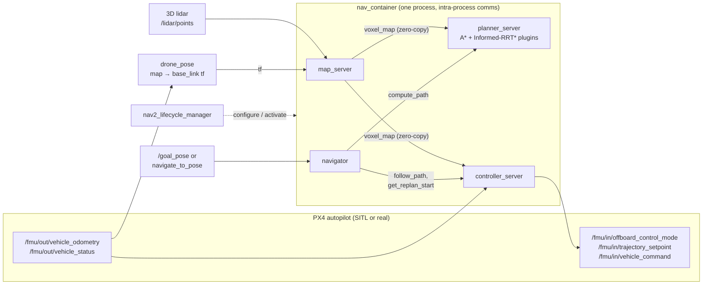
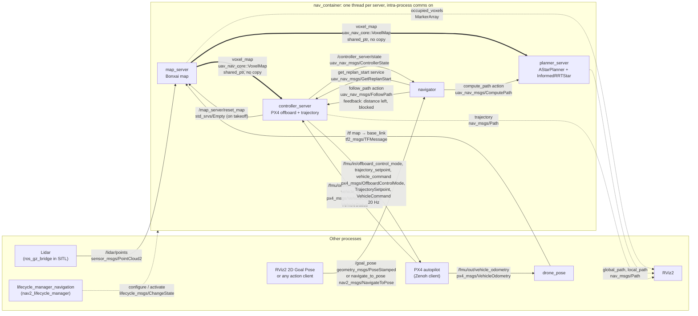
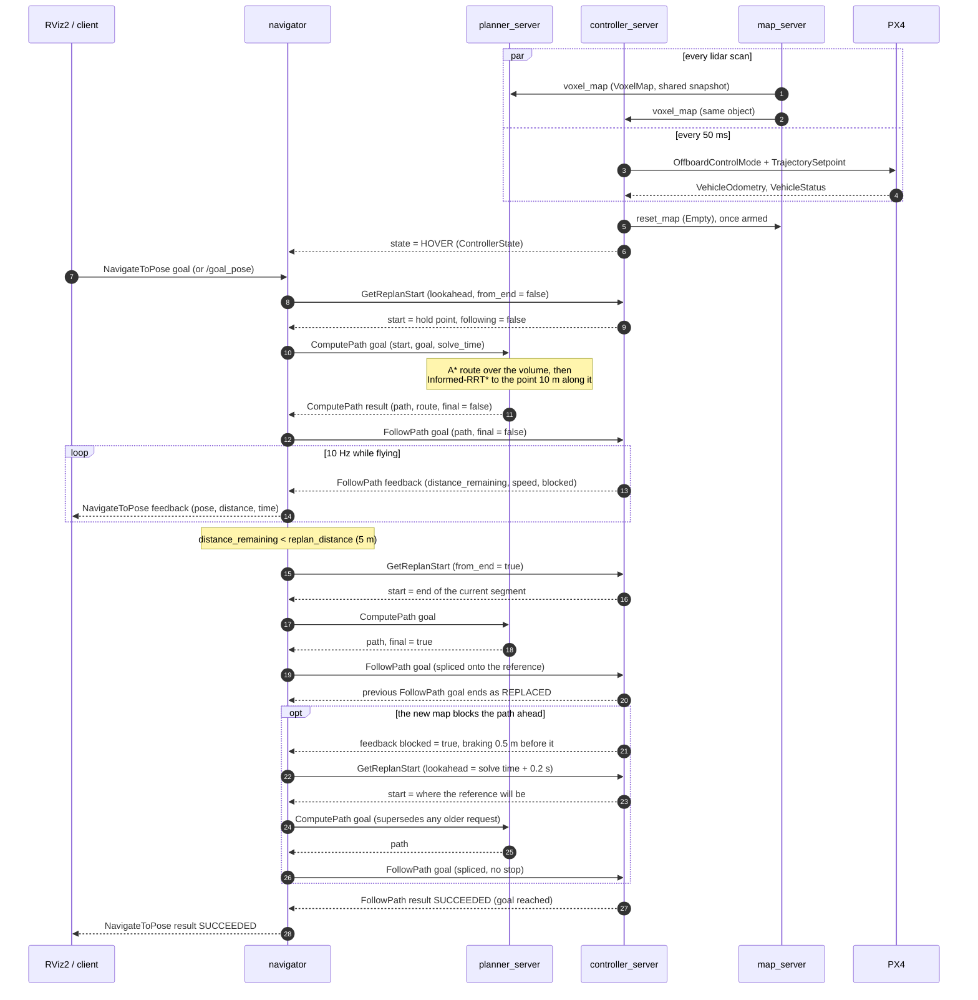
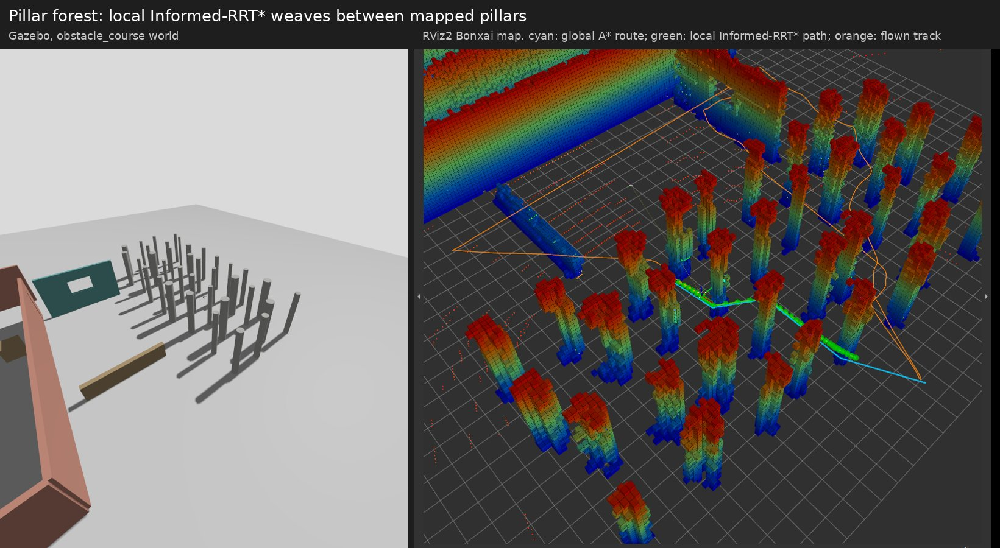
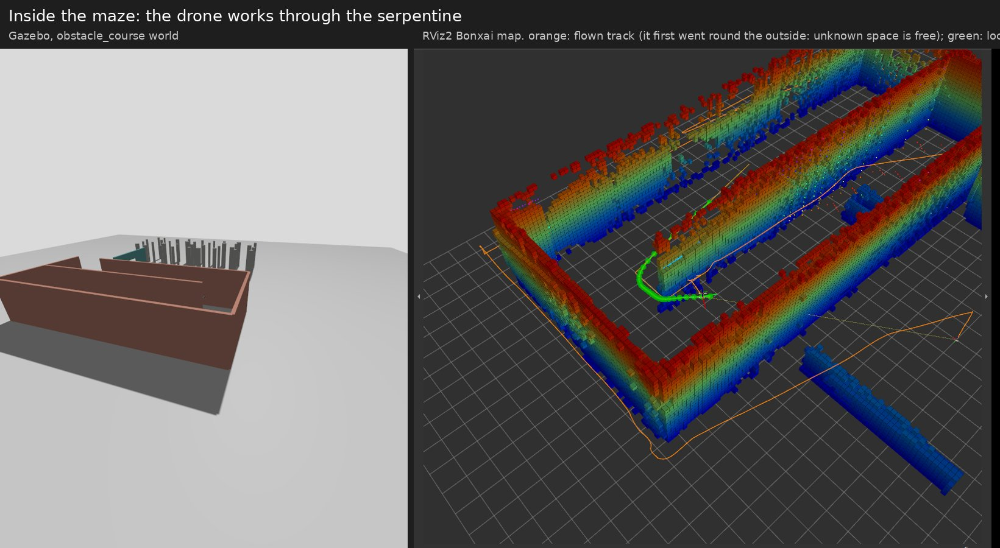
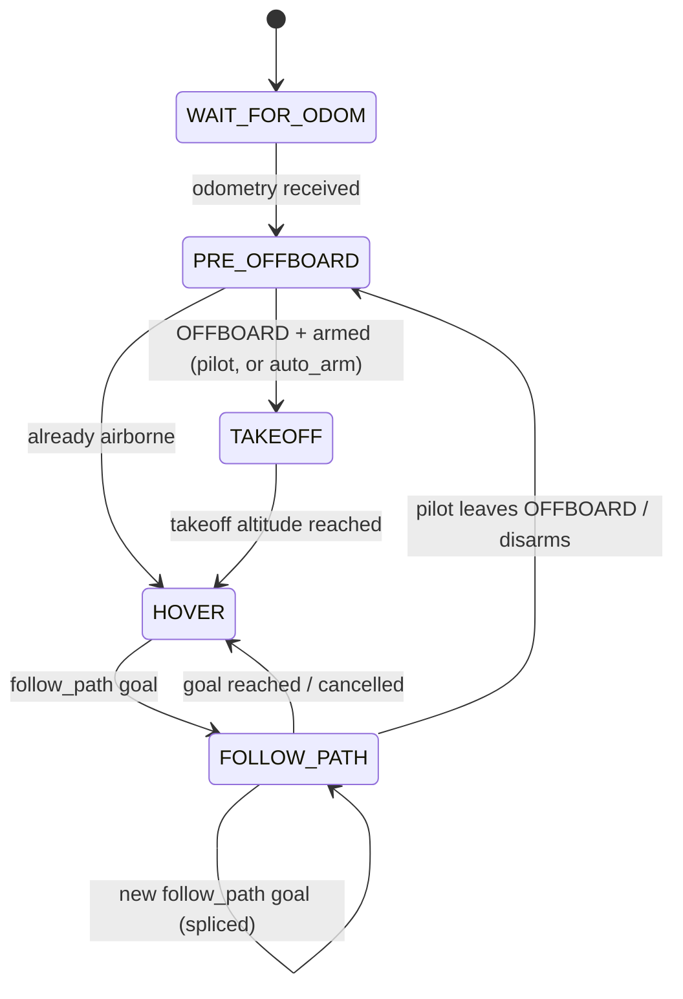

<div id="header" align="center">
  
</div>

# ROS-Informed-RRT* planner

Autonomous 3D navigation with obstacle avoidance for a PX4 multirotor on ROS 2.

Give it a goal, for example with RViz2's **2D Goal Pose**. The planner:

1. Builds a 3D occupancy map from a lidar as the drone flies.
2. Plans a coarse global route to the goal with A*, and the flyable path along it with
   Informed-RRT*, a few metres at a time.
3. Flies the path smoothly in PX4 OFFBOARD mode.
4. Replans in flight whenever newly mapped obstacles block the path.

It runs on ROS 2 Lyrical with PX4 main. PX4 is reached through its native Zenoh client and
`rmw_zenoh_cpp`; the uXRCE-DDS bridge also works. The whole stack is tested end to end in PX4
SITL with Gazebo Jetty.

Like [Nav2](https://docs.nav2.org/), it is split into lifecycle servers, each in its own
package, brought up by `nav2_lifecycle_manager`:

| Package | What it holds |
|-|-|
| [`uav_nav_msgs`](uav_nav_msgs/) | the map message, `ComputePath` and `FollowPath` actions, `GetReplanStart` service |
| [`uav_nav_core`](uav_nav_core/) | Bonxai map, collision checks, the zero-copy `VoxelMap` type adapter, planner plugin interfaces |
| [`uav_map_server`](uav_map_server/) | lidar → 3D occupancy map |
| [`uav_planner_server`](uav_planner_server/) | `compute_path`: global route + local path, through plugins |
| [`uav_planners`](uav_planners/) | the plugins: A* (global) and Informed-RRT* (local) |
| [`uav_controller_server`](uav_controller_server/) | `follow_path`: PX4 offboard control, trajectory following, blocked-path detection |
| [`uav_navigator`](uav_navigator/) | `navigate_to_pose` (`nav2_msgs`): drives the planner and the controller |
| [`uav_nav_bringup`](uav_nav_bringup/) | launch, parameters, RViz view, PX4 SITL model and worlds |

The bringup [README](uav_nav_bringup/README.md) is the short reference for build commands,
launch arguments and interfaces. This page explains what the system does and how.

## How it works



**[`drone_pose`](https://github.com/Fixit-Davide/PX4-ROS2-Drone-Composable)** (separate repo)
turns PX4's `VehicleOdometry` (NED position, FRD attitude) into the `map → base_link` tf, a
`/vehicle_pose` and a bounded `/vehicle_path` track. A static `base_link → lidar_link` tf
places the sensor.

The four navigation servers are lifecycle components. By default
(`use_composition:=true`) they are loaded into one component container, one executor
thread each, so a planner solve or a map update never delays the setpoint stream to PX4.
`nav2_lifecycle_manager` configures and activates them in order: map, planner, controller,
navigator. The stages are described below, after how the servers talk to each other.

### How the servers communicate

**Data routes.** Every arrow is one topic, action or service, labeled with its name and
message type. Thick arrows stay inside the container and are zero-copy. Dotted arrows are for
visualization and lifecycle only.



| Exchange | Kind | From → to | Message | Notes |
|-|-|-|-|-|
| `/lidar/points` | topic | lidar → map_server | `sensor_msgs/PointCloud2` | sensor-data QoS, held until its tf is known |
| `voxel_map` | topic | map_server → planner, controller | `uav_nav_core::VoxelMap` ⇄ `uav_nav_msgs/VoxelMap` | volatile, keep last 1, after every scan; zero-copy in the container |
| `compute_path` | action | navigator → planner_server | `uav_nav_msgs/ComputePath` | goal: start, goal, solve time; result: path, route, `final` |
| `get_replan_start` | service | navigator → controller_server | `uav_nav_msgs/GetReplanStart` | where the next plan must start; the controller splices there |
| `follow_path` | action | navigator → controller_server | `uav_nav_msgs/FollowPath` | a new goal replaces the old one (`REPLACED`); cancel = brake and hover |
| `~/state` | topic | controller_server → navigator | `uav_nav_msgs/ControllerState` | transient local, on change and at 2 Hz |
| `/map_server/reset_map` | service | controller_server → map_server | `std_srvs/Empty` | on takeoff |
| `/fmu/in/*`, `/fmu/out/*` | topics | controller_server ⇄ PX4 | `px4_msgs/*` | setpoint stream at `rate_hz` (20 Hz) |
| `navigate_to_pose`, `/goal_pose` | action, topic | client → navigator | `nav2_msgs/NavigateToPose`, `geometry_msgs/PoseStamped` | Nav2's own goal interface |

**One navigation, step by step.** The goal arrives while the drone hovers. The first
segment ends `local.horizon` along the route, the second is planned before the first ends,
and a newly mapped obstacle forces one replan:



If every retry fails, the navigator cancels the `follow_path` goal instead: the controller
stops along the path and hovers, and the navigation is aborted.

At start-up `nav2_lifecycle_manager` calls `configure` then `activate` on map_server,
planner_server, controller_server and navigator, in that order. Each server reads its
parameters and creates its publishers in `configure`, and starts its subscriptions, timers and
action servers in `activate`, so nothing moves before every server is ready.


### 1. Mapping (Bonxai, `map_server`)

The map server subscribes to the lidar cloud (`topics.cloud`) and inserts every scan into a
probabilistic occupancy map built with [Bonxai](https://github.com/facontidavide/Bonxai), at
`resolution` (0.2 m):

- **Ray casting:** each ray lowers the occupancy of the voxels it crosses and raises it where
  it hits, with the same sensor model as octomap_server (hit 0.7, miss 0.4, clamping
  0.12–0.97). Rays longer than `max_range` (15 m) only clear free space.
- **Ground filter:** points outside `min_z`–`max_z` (0.3–6 m) in the map frame are
  dropped, so the ground is not mapped as an obstacle.
- **Timing:** a scan is held back by a tf message filter until `map → lidar frame` is known
  at its stamp. In SITL, inserting a 16-channel scan takes about 3–4 ms, and the map of the
  walls world takes about 0.3 MB.
- **Visualization:** the occupied voxels are published as height-coloured cubes on
  `~/occupied_voxels` at `markers.publish_rate_hz` (2 Hz).

**Zero-copy map transport.** After every scan the map server copies the occupied voxels into
an immutable snapshot and publishes it on `voxel_map` as a `uav_nav_core::VoxelMap`: a header
plus a `shared_ptr` to that snapshot. An `rclcpp::TypeAdapter` ties this C++ type to the
`uav_nav_msgs/VoxelMap` message (resolution + cell coordinates):

- **Inside the container**, with intra-process comms on, the planner and controller servers
  receive the published object itself. Nothing is converted, serialized or copied, and since
  the snapshot is immutable no lock is needed either.
- **Outside the container** (`ros2 topic echo`, or `use_composition:=false`), subscribers get
  the ROS message. rclcpp builds it only when such a subscriber exists.

The topic is volatile on purpose: with transient-local durability rclcpp converts every
message to keep it for late joiners. The map is republished every second when no scan comes
in, so a late subscriber still gets one. Measured:

- **SITL:** the map server reports `2 intra-process / 2 total subscribers`. At about 11 000
  voxels, snapshot + publish takes 2.6 ms per scan in the container, and 4.9 ms with
  `use_composition:=false`, where each subscriber also has to rebuild the snapshot from the
  message.
- **Unit test:** a 200 000-voxel map reaches two subscribers in 0.13 ms, against 17 ms
  (2.4 MB) just to convert it to and from the message.

The map server used to be `octomap_server`. [docs/bonxai_eval](docs/bonxai_eval/) compares
the two on recorded SITL scans. Bonxai inserts scans 8.8× faster at 0.2 m, and 16.6× faster
at 0.1 m, a resolution at which octomap_server can no longer keep up with a 10 Hz lidar.

### 2. Collision checking

Collisions are checked against the latest snapshot, which the servers can use while the map
keeps changing. The drone is modeled as a box, `robot.size`, by default 0.9 × 0.9 × 0.6 m:
the x500 airframe plus a safety margin.

- **States:** a position is free when that box overlaps no occupied voxel. The check looks up
  the voxels under the box, about 2 µs at 0.2 m. On the recorded tour it agrees with FCL's
  box-versus-octree test on 99.97 % of states.
- **Segments:** a segment is free when every sample along it, every
  `collision_check_resolution` (0.1 m), is free.
- **Clearance:** the distance from the box to the nearest occupied voxel, used by the
  `balanced` objective. It searches 8³-voxel blocks with a bounding-box lower bound, about
  8 µs per query.

Two collision worlds share the same snapshot:

- **Planning world** (planner server): the box grown by `robot.planning_margin` (0.15 m per
  side).
- **Checking world** (controller server): the plain box, used to recheck paths that are
  already planned.

A new voxel therefore has to intrude more than the margin into a path's clearance before the
path counts as blocked. Without this hysteresis, every scan near a wall would trigger a
replan, because RRT* paths hug the boundary they are planned with.

### 3. Path planning: global A* route, local Informed-RRT* path (`planner_server`)

The planner server serves the `compute_path` action (`uav_nav_msgs/ComputePath`) on a worker
thread. The newest request wins: a solve still running for an older one stops early and
is reported as `CANCELED`, so stale paths are never handed out. It plans in the 3D position
space (R³) inside the box `bounds.min`–`bounds.max`, by default 40 × 40 m and 0.5–4 m in
altitude. Yaw is not part of the search: the drone yaws along the path.

Each request has two levels, and each level is a [pluginlib](https://github.com/ros/pluginlib)
plugin of the `uav_nav_core::GlobalPlanner` / `LocalPlanner` interfaces, picked by
`global_planner.plugin` and `local_planner.plugin` like Nav2's planner plugins. The
`uav_planners` package provides the two below.

**Global route (`uav_planners::AStarPlanner`, `global_planner.*`):**

- **Search:** A* over the whole volume on a lattice of robot positions, spaced
  `global_planner.resolution` (0.4 m) apart.
- **Valid nodes:** a node is usable when the planning box fits there.
- **Moves:** each node connects to its 26 neighbours. A diagonal move must not cut a corner:
  every lattice node on the corners of the cube it spans must be free too. This makes the
  move exactly collision free, as long as the step is no larger than the box.
- **Snapping:** a start or goal inside an inflated obstacle is snapped to the nearest free
  node within 1.2 m.
- **Shortcutting:** the node chain is shortcut by line of sight, so the route is a few
  straight segments.
- **Cost:** in the walls world, A* takes 2–86 ms (14 ms on average), versus the 1 s that
  Informed-RRT* spent on every request before.

**Local path (`uav_planners::InformedRRTStar`, `local.*` and `local_planner.*`):**

- **Local goal:** the point `local.horizon` (10 m) along the route, or the goal if it is
  closer.
- **Window:** RRT* samples only inside that part of the route's bounding box, plus
  `local.window_margin` (2 m) on each side and the full altitude band.
- **Straight lines:** if the straight line from the start to the local goal is free
  (`local.direct_if_visible`), it is the path. Informed-RRT* would only converge to it, so
  the solve is skipped. On the walls tours that covered 14 of 32 plans.
- **Planner:** otherwise [OMPL](https://ompl.kavrakilab.org/)'s Informed-RRT* plans within
  the window. It's an anytime planner: it uses the whole solve time (0.5 s) budget,
  and once it has a solution it samples only inside the ellipsoid that could still improve
  on it.
- **Next segment:** when less than the navigator's `replan_distance` (5 m) of a segment is
  left, the next one is planned from the segment's end, which lies on the route. The drone flies the
  current segment to its end, the two meet roughly in line, and every join on the walls tours
  kept cruise speed (1.35–1.5 m/s). Only the last segment ends at the goal.
- **Fallback:** if Informed-RRT* finds no exact path in the window
  (`local.fallback_to_route`, on by default), the drone flies the A* route up to the local
  goal instead. The route is already collision free for the planning box, so this is safe,
  and it keeps the drone moving in tight spaces such as a maze, where RRT* can run out of
  time between close walls.

`use_global: false` turns the global level off. Informed-RRT* then plans all the way to
the goal over the whole volume, as before.

Common to both modes:
- **Objective** (`local_planner.objective`):
  - `path_length`: shortest path.
  - `path_length_cost_to_go`: shortest path, with a cost-to-go heuristic. This is the default.
  - `threshold`: stop at the first path shorter than `cost_threshold`.
  - `balanced`: trade length against clearance from obstacles, using plain RRT*.
- **Invalid starts or goals:** a start or goal inside an inflated obstacle, for example when
  the drone hovers close to a wall, is moved to the nearest valid state within 1.2 m.
- **Post-processing:** the solution is shortcut, smoothed with a B-spline (kept only if still
  collision-free), and the server re-samples every local path every `waypoint_spacing` (1 m).
- **Retries:** the navigator retries a failed plan up to `max_attempts` (3) times, each with
  twice the previous solve time (0.5, 1, then 2 s).

Compared with Informed-RRT* to the goal (1 s solves), three SITL walls tours gave:

| | RRT* to the goal | global A* + local RRT* |
|---|---|---|
| Open 10 m legs | 10.5 s (1 s solve before moving) | 10.0 s (straight line, about 15 ms) |
| Legs through the walls | 26.1 s mean, 22.8–33.1 s, up to 42 m flown | 24.5 s mean, 22.7–27.1 s, 26–27 m |
| Time spent in RRT* | 20 s over 20 solves | 9 s over 18 solves |
| Replans because the path was blocked | 8 | 6 |

**Obstacle course.** The `obstacle_course` world (see [Run](#in-simulation-px4-sitl--gazebo))
has a closed maze of 5 m walls, a field of 36 pillars, a wall with a window and a low wall.
A four-goal mission reached every goal, both with the single node this started as and with
the servers:

| Leg | Single node | Servers (one container) | Notes |
|---|---|---|---|
| Into the maze | 129 s, 145 m | 56.7 s, 57 m | single node: went round the outside first, 3 route fallbacks |
| Through the pillar field | 22–55 s | 55.0 s | |
| Through the window | 23–26 s | 28.4 s | |
| Over the low wall | 16.5 s | 16.4 s | |

The servers' run replanned 12 times on blocked paths, with no failed plan and no route
fallback. Each column is one or two runs, and the maze leg varies most: A* treats unmapped
space as free, so how far the drone goes round the outside of the closed maze depends on when
its walls get mapped.


*Pillar field. Left Gazebo, right RViz: A* route in cyan, local Informed-RRT\* path in green,
flown track in orange, mapped obstacles as voxels.*


*Inside the maze; the track shows the first detour round the outside.*

### 4. Path following (`controller_server`)

The controller server is the only node that talks to PX4. It serves the `follow_path`
action (`uav_nav_msgs/FollowPath`). A waypoint list fed to PX4 as bare position setpoints
makes the drone surge toward each waypoint and brake at it. Instead, the path is flown as a
trajectory.

- **Speed profile** (`PathTrajectory`): the path is parameterized by arc length, with a speed
  limit along it:
  - at most `max_speed` (1.5 m/s);
  - corner speeds from `max_lateral_accel` and the turn angle at each waypoint;
  - a stop at the goal;
  - all of it reachable by braking at `max_accel`.
- **Reference:** every control tick (20 Hz) a reference point advances along the path. Its
  acceleration is limited to `max_accel` (braking up to twice that), and changes by at most
  `max_jerk` (2 m/s³). It tapers off before the speed limit, and braking looks ahead
  so it can ramp in smoothly.
- **What PX4 receives:** a `TrajectorySetpoint` with the reference position, velocity and
  acceleration as feed-forward, plus a yaw that follows the path direction at up to
  `max_yaw_rate`.
- **Lag guard:** if the drone falls more than `tracking_lag_soft` (1 m) behind, the
  reference slows down, and it waits at `tracking_lag_max` (2 m).

In SITL this turned a stop-and-go 10 m leg (speed oscillating between 0.6 and 0.8 m/s,
16.6 s) into one acceleration, a 1.5 m/s cruise and one stop (10.5 s), with under 0.2 m of
tracking error.

- **Splicing:** a new `follow_path` goal replaces the running one without stopping. The new
  path is joined onto the current reference, so position and speed stay continuous.
- **Cancel:** cancelling the goal brakes along the path, then hovers.

### 5. Navigation and replanning in flight (`navigator`)

The navigator turns a goal, from `/goal_pose` (RViz) or the `nav2_msgs/NavigateToPose`
action, into `compute_path` requests and `follow_path` goals, the role Nav2's bt_navigator
plays there:

- **Before takeoff** it waits until the controller reports `HOVER`.
- **Where a plan starts** comes from the controller's `~/get_replan_start` service: the hold
  point when hovering, the end of the current segment for the next segment, or the point the
  reference will have reached when the plan is ready (it keeps moving meanwhile). The
  controller splices the next `follow_path` goal exactly there.
- **Next segments** are requested from the controller's feedback (`distance_remaining`).

At `block_check_rate_hz` (2 Hz) the controller rechecks the rest of the path against the
newest map. When newly mapped obstacles block it:

- **The drone keeps flying.** It brakes along the path only if the blocked section is within
  reach, stopping `stop_margin` (0.5 m) before it, and reports `blocked` in the feedback.
- **The navigator replans** from just ahead of the reference, with a fresh global route.
- **The new path is spliced on**, as above.

A new goal sent mid-flight is handled the same way. When every retry fails, the navigator
cancels the `follow_path` goal (the drone stops along the path and hovers) and aborts the
navigation.

### 6. Flight state machine (`controller_server`)



The state is published on `~/state` (`uav_nav_msgs/ControllerState`).

**Before a goal:**

- The controller streams `OffboardControlMode` and a setpoint at `rate_hz`. PX4 needs more
  than 2 Hz to accept and keep OFFBOARD, so deactivating the controller makes PX4 fail over.
- With `auto_arm` the controller switches PX4 to OFFBOARD and arms it itself, which is
  meant for simulation. Otherwise the pilot does both from the RC or ground station.
- Once armed it asks the map server to reset the map (`/map_server/reset_map`), then climbs
  to `takeoff_altitude` (2 m).

**Pilot takeover:** if the pilot leaves OFFBOARD or disarms, the path is dropped and the
`follow_path` goal aborted (`PILOT_OVERRIDE`). The controller will not request OFFBOARD again
until the vehicle has been disarmed, so it never fights the pilot.

## Repository layout

```
uav_nav_msgs/                 VoxelMap, ControllerState, ComputePath, FollowPath, GetReplanStart
uav_nav_core/
├── occupancy_map.hpp         Bonxai lidar map + immutable occupied-voxel snapshots
├── collision_world.hpp       robot box collision and clearance queries on a snapshot
├── voxel_map.hpp             VoxelMap + its rclcpp::TypeAdapter (zero-copy map transport)
├── polyline.hpp              length, point at arc length, truncate, densify
├── global_planner.hpp        plugin interfaces of the planner server
└── local_planner.hpp
uav_map_server/               MapServer: lidar -> map -> voxel_map
uav_planners/
├── astar.hpp                 A* route on a lattice of robot positions + shortcutting (no ROS)
├── astar_planner.hpp         ... as a GlobalPlanner plugin
└── informed_rrt_star.hpp     OMPL Informed-RRT* as a LocalPlanner plugin
uav_planner_server/           PlannerServer: compute_path, route + local path through plugins
uav_controller_server/
├── controller_server.hpp     ControllerServer: PX4 offboard, follow_path, get_replan_start
├── path_trajectory.hpp       arc-length path, speed profile, projection
└── px4_frames.hpp            NED/FRD <-> map frame (NWU or ENU) conversions
uav_navigator/                Navigator: navigate_to_pose, segment chaining, replans, retries
uav_nav_bringup/
├── config/nav.yaml           parameters of every server (commented)
├── config/nav.rviz           RViz2 view: map, cloud, route, trajectory, drone
├── launch/bringup.launch.py  servers (+ lifecycle manager, mapping, Gazebo bridge, RViz2)
├── launch/mapping.launch.py  drone_pose, lidar tf, ros_gz_bridge
└── sim/
    ├── models/x500_lidar_3d/      Gazebo model: PX4 x500 + 16-channel 3D lidar
    ├── worlds/obstacle_course.sdf maze, pillar field, window wall and low wall
    └── run_px4_sitl.sh            starts PX4 SITL with that model (walls world by default)
docs/bonxai_eval/             Bonxai vs octomap benchmark, scripts and results
docs/images/                  screenshots used in this README
```

Unit tests (gtest): map and collision checks, polylines and the `VoxelMap` adapter
(`uav_nav_core`), A* and both plugins loaded through pluginlib (`uav_planners`), and the
trajectory (`uav_controller_server`).

## Requirements

| What | Version used |
|-|-|
| ROS 2 | Lyrical (source build), C++20 |
| PX4 | main (built against the same Gazebo) |
| Gazebo | Jetty (gz-sim 10), the `gz_*_vendor` packages of ROS 2 |
| Middleware | `rmw_zenoh_cpp` + PX4's Zenoh client (or uXRCE-DDS) |
| Libraries | OMPL 1.6, Eigen 3, PCL (for Bonxai's ROS package) |
| ROS packages | [`px4_msgs`](https://github.com/PX4/px4_msgs), [`bonxai_ros`](https://github.com/facontidavide/Bonxai) (clone into the workspace), [`drone_pose`](https://github.com/Fixit-Davide/PX4-ROS2-Drone-Composable), `nav2_msgs`, `nav2_lifecycle_manager`, `ros_gz_bridge`, `rviz2` |

`px4_msgs` must match the PX4 commit you fly. Zenoh topic names carry the message type hash,
so a different message definition silently fails to connect.

## Build

```bash
source ~/ros2_lyrical/install/setup.bash
cd ~/ros2_ws/src && git clone https://github.com/facontidavide/Bonxai.git   # package bonxai_ros
cd ~/ros2_ws && colcon build --packages-up-to uav_nav_bringup drone_pose
```

Unit tests:

```bash
colcon build --packages-up-to uav_nav_bringup --cmake-args -DBUILD_TESTING=ON
colcon test --packages-select uav_nav_core uav_planners uav_controller_server
colcon test-result --verbose
```

## Run

Every terminal needs `source ~/ros2_ws/install/setup.bash` and
`export RMW_IMPLEMENTATION=rmw_zenoh_cpp`.

### In simulation (PX4 SITL + Gazebo)

```bash
ros2 run rmw_zenoh_cpp rmw_zenohd                     # Zenoh router: PX4 and ROS 2 meet here
uav_nav_bringup/sim/run_px4_sitl.sh                   # PX4 + Gazebo, x500_lidar_3d in the walls world
# or: PX4_GZ_WORLD=obstacle_course uav_nav_bringup/sim/run_px4_sitl.sh
ros2 launch uav_nav_bringup bringup.launch.py use_sim_time:=true auto_arm:=true gz_bridge:=true rviz:=true
```

**What the launcher does:**

- `run_px4_sitl.sh` links the lidar model into PX4 and starts SITL with PX4's Zenoh
  middleware.
- Set `HEADLESS=1` to run without the Gazebo window, or `PX4_GZ_WORLD=<name>` to pick another
  world. The worlds in `uav_nav_bringup/sim/worlds` (`obstacle_course`) are linked into PX4, so
  they can be picked by name.
- Arguments are passed to the `px4` binary. Add `-d` when running it without a terminal (for
  example under `nohup`); otherwise PX4's shell prints its prompt in a loop and fills the log.

**What the launch options do:**

- `gz_bridge:=true` bridges the Gazebo lidar cloud and `/clock` into ROS. The cloud is stamped
  with simulation time, which is why `use_sim_time:=true` is required.
- `auto_arm:=true` lets the controller arm and take off by itself.
- `rviz:=true` opens the navigation view.
- `use_composition:=false` runs every server in its own process. The map then travels as
  `uav_nav_msgs/VoxelMap` messages; useful to debug or restart one server alone.

**Arming without a GCS:** PX4 refuses to arm while `NAV_DLL_ACT > 0` and no ground station is
connected. Either run QGroundControl, or set `NAV_DLL_ACT` to 0, on the ground only, for
headless tests.

### On a real drone

```bash
ros2 run rmw_zenoh_cpp rmw_zenohd
ros2 launch uav_nav_bringup bringup.launch.py
```

The pilot switches to OFFBOARD and arms. Point the map server's `topics.cloud` at the real
sensor's cloud, and `lidar_frame` and `lidar_z` of `mapping.launch.py` at its mounting.

### Sending goals

In RViz2, use **2D Goal Pose**, publish on `/goal_pose`, or send the Nav2 action, which
also reports progress and can be cancelled:

```bash
ros2 topic pub --once /goal_pose geometry_msgs/msg/PoseStamped \
  "{header: {frame_id: map}, pose: {position: {x: 0.0, y: -8.0, z: 2.0}, orientation: {w: 1.0}}}"
ros2 action send_goal /navigate_to_pose nav2_msgs/action/NavigateToPose \
  "{pose: {header: {frame_id: map}, pose: {position: {x: 0.0, y: -8.0, z: 2.0}}}}" --feedback
```

A goal below `bounds.min` z, such as RViz's z = 0, is flown at the navigator's
`default_goal_altitude`. Goals outside `bounds` are clamped into them.

## Interfaces

| Topic / action / service | Type | Node |
|-|-|-|
| `/lidar/points` | `sensor_msgs/PointCloud2` | in: map_server |
| `voxel_map` | `uav_nav_msgs/VoxelMap` (as `uav_nav_core::VoxelMap` in the container) | map_server → planner_server, controller_server |
| `/map_server/occupied_voxels` | `visualization_msgs/MarkerArray` | out (transient local), map cubes |
| `/map_server/reset_map` | `std_srvs/Empty` | service: clear the map (also done on takeoff) |
| `compute_path` | `uav_nav_msgs/ComputePath` | action: planner_server |
| `/planner_server/global_path` | `nav_msgs/Path` | out (transient local), A* route |
| `/planner_server/local_path`, `path_markers` | `nav_msgs/Path`, `MarkerArray` | out (transient local), last local path |
| `follow_path` | `uav_nav_msgs/FollowPath` | action: controller_server |
| `/controller_server/get_replan_start` | `uav_nav_msgs/GetReplanStart` | service: controller_server |
| `/controller_server/state` | `uav_nav_msgs/ControllerState` | out (transient local) |
| `/controller_server/trajectory` | `nav_msgs/Path` | out (transient local), the spliced path being flown |
| `/fmu/out/vehicle_odometry`, `vehicle_status` | `px4_msgs` | in: controller_server |
| `/fmu/in/offboard_control_mode`, `trajectory_setpoint`, `vehicle_command` | `px4_msgs` | out: controller_server |
| `navigate_to_pose` | `nav2_msgs/NavigateToPose` | action: navigator |
| `/goal_pose` | `geometry_msgs/PoseStamped` | in: navigator |

All topic names are parameters (`topics.*`). The uXRCE-DDS bridge may add a `_vN` suffix to
versioned PX4 messages. Check `ros2 topic list` and adjust them if so.

## Frames

PX4 works in NED, with an FRD body frame. The servers, the map and RViz use `map_frame`
(z up). The controller's `frame_convention` selects the mapping:

- **`nwu`** (default): x = North, y = West. This is what `drone_pose` publishes.
- **`enu`**: x = East, y = North, as in REP-103.

It must match whatever publishes `map → base_link`, or the map and the drone will not line
up. With `nwu`, RViz shows the scene mirrored compared with Gazebo's ENU world.

## Known issues

- **OMPL 1.6 GNAT bug:** OMPL 1.6's default nearest-neighbor structure,
  `NearestNeighborsGNAT`, returns duplicate tree nodes after a start state has been moved out
  of an obstacle, and RRT* then frees a node twice and segfaults. Both planners therefore use
  `NearestNeighborsSqrtApprox`.
- **Overshoot and corner clearance:** PX4 briefly overshoots the commanded speed, to about
  1.8–1.9 m/s at 1.5 m/s, when reaching cruise speed or leaving a corner. The tightest SITL
  pass left about 0.17 m between airframe and wall. Lower the controller's `max_speed` or
  `max_lateral_accel` for more clearance.
- **NaN samples on open legs:** when the straight line to the goal is free, Informed-RRT*
  finds an almost optimal path at once, its informed ellipsoid collapses, and OMPL samples
  NaN states for the rest of the solve time. They are rejected before the collision check
  and counted in a warning; the path found is unaffected.
- **Unknown space is free:** only mapped obstacles are avoided. Fly slower than the lidar can
  map ahead.
- **Lifecycle publishers and type adapters:** `rclcpp_lifecycle::LifecyclePublisher` has no
  type-adapted `publish(unique_ptr)`, so the map server publishes `voxel_map` with a plain
  rclcpp publisher and only while active.

## History

This started as a ROS 1 / MAVROS / ArduPilot planner (GUIDED mode, `CommandTOL` takeoff,
goals and objective typed on stdin). The `ros2` branch is the ROS 2 Lyrical + PX4 port.
Compared with the ROS 1 version:

- **ROS 2 and PX4:** composable nodes, PX4 OFFBOARD control and parameters instead of prompts.
- **Libraries:** FCL + OctoMap were replaced by a Bonxai map.
- **Search space:** SE(3) became R³, since random orientations were wasted samples.
- **Pipeline:** lidar mapping, the trajectory follower, replanning in flight, plan retries and
  the planning margin are new.
- **Servers:** the single `path_planning` node was split, Nav2 style, into map, planner,
  controller and navigator lifecycle servers, with the planners as plugins and the map
  shared zero-copy between them.
- **Bug fixes:** several ROS 1 bugs, such as the undefined clearance objective, an infinite
  loop in the objective selection and blocking planning in callbacks.

`main` keeps the ROS 1 code.
